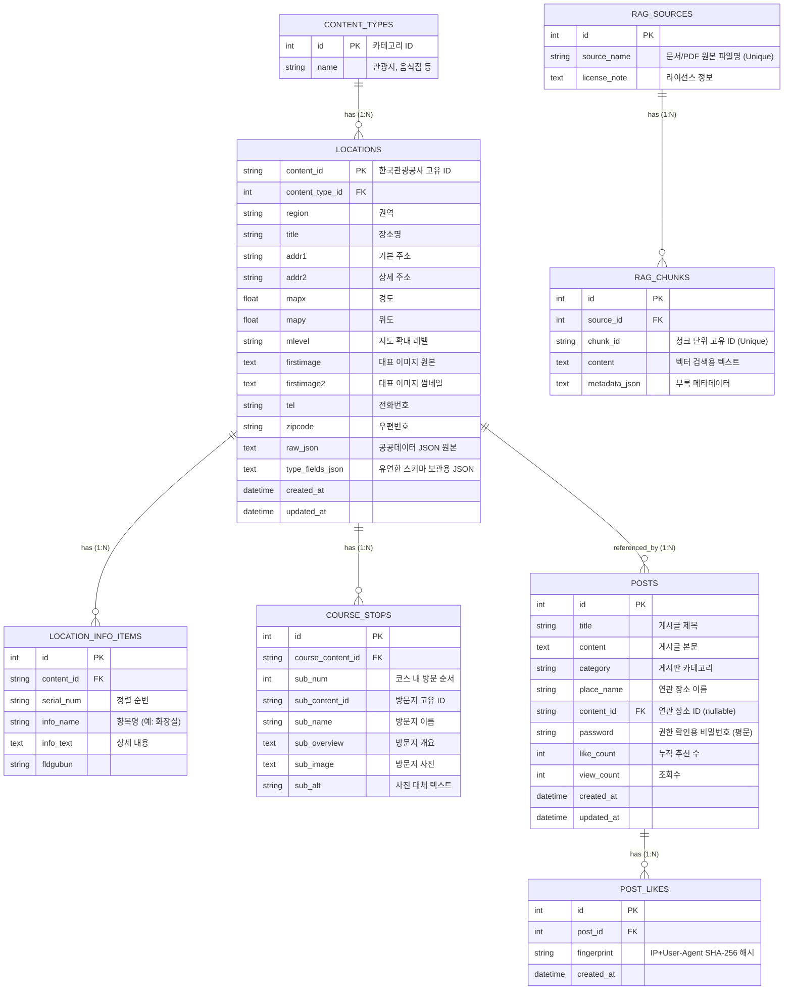

# LocalHub 데이터베이스 ERD (Entity-Relationship Diagram)

본 프로젝트는 공공데이터 기반 장소 정보와 익명 커뮤니티, RAG 챗봇 데이터를 관리하기 위해 SQLite와 SQLAlchemy ORM을 사용하여 데이터베이스 스키마를 설계했습니다.

### 주요 설계 포인트
1. **Flexible Schema (유연한 스키마)**: 
   - `LOCATIONS` 테이블은 관광지, 축제, 음식점 등 각 카테고리(`CONTENT_TYPES`)마다 상이한 속성을 가집니다. 이를 고정 컬럼으로 만들지 않고 `type_fields_json`이라는 Text 필드에 JSON으로 밀어넣어 유연하게 수용했습니다.
2. **익명 환경 중복 방지 (Fingerprinting)**:
   - `POST_LIKES` 테이블은 로그인 및 회원이 없는 익명 시스템에서 중복 좋아요를 방지하기 위해 사용자의 IP와 브라우저 헤더를 조합해 해싱한 `fingerprint`를 기록합니다.
3. **평문 비밀번호**:
   - `POSTS` 테이블의 `password`는 의뢰서의 '교육 목적' 설계 지침에 따라 의도적으로 암호화 없이 평문으로 저장됩니다.
4. **Vector DB 이중화 구조**:
   - RAG 챗봇을 위한 임베딩 자체는 파일 기반 FAISS(.cache 폴더)에 저장되지만, 해당 원본 텍스트 및 메타데이터는 관계형 DB인 `RAG_SOURCES`와 `RAG_CHUNKS`에 저장하여 무결성을 유지합니다.
